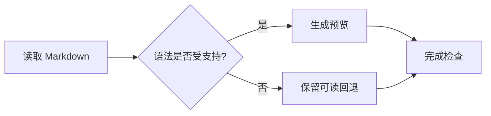
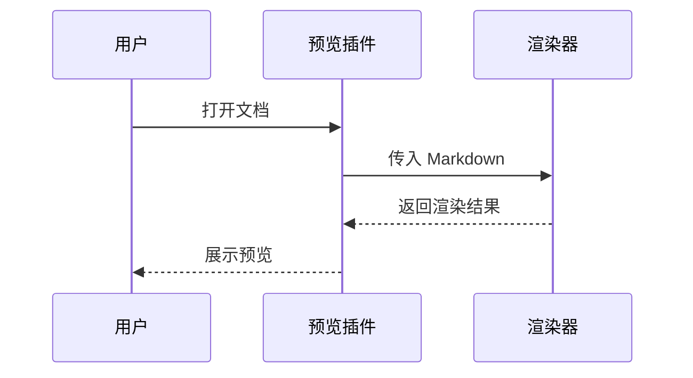
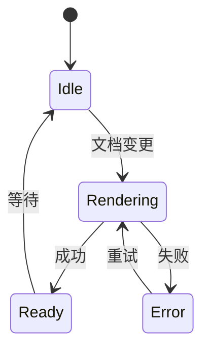
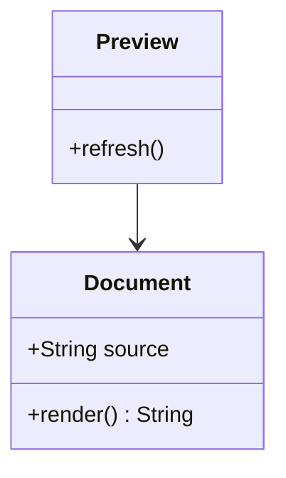
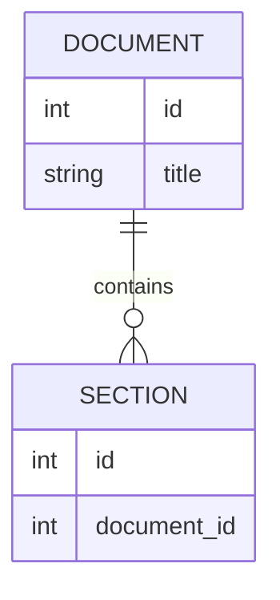
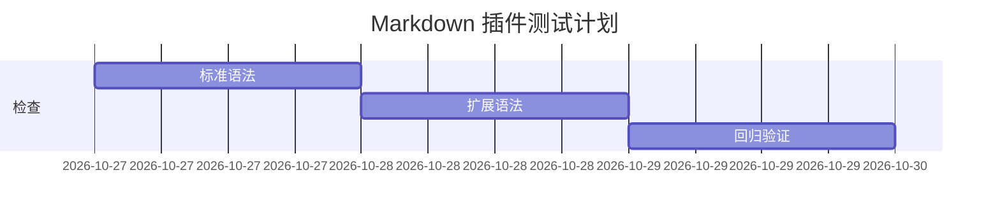
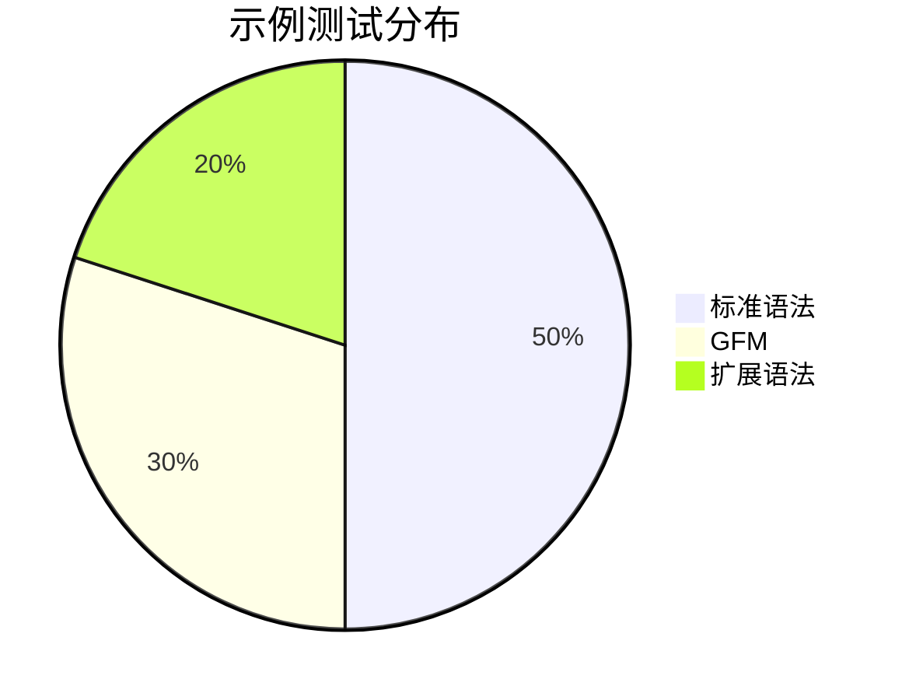
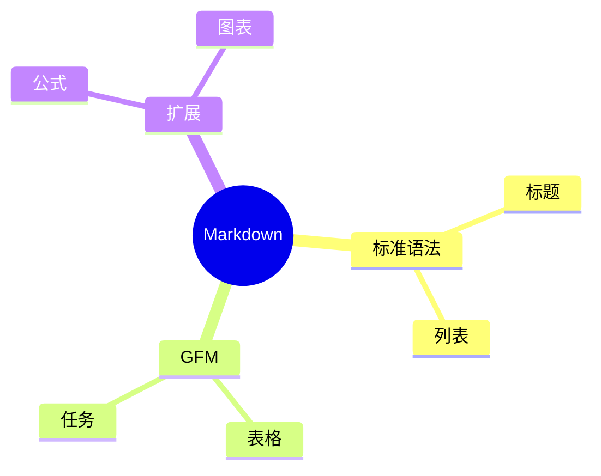
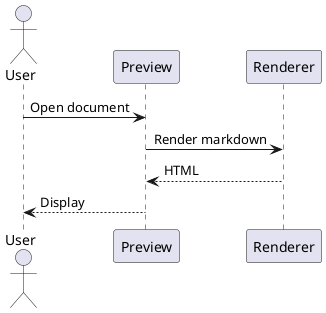

# Markdown 预览插件全要素测试模板

> 使用说明：从上到下观察渲染结果，并对照源代码检查。Markdown 没有囊括所有扩展的统一全集；本文件覆盖标准 Markdown / CommonMark、GitHub Flavored Markdown（GFM）及多种常见扩展。扩展语法不保证被所有渲染器支持；不同扩展也可能相互冲突。标记为“扩展”的章节可以按插件目标选择启用。
>
> 本文件同时包含有效语法、故意不完整的语法和布局压力样例。未启用的扩展通常会显示为普通文本或代码块。配套的 `markdown-preview-test-assets` 目录用于本地资源和相对链接测试，请与此文件一同保留。

## 目录与跳转

- [标题](#headings)
- [段落与换行](#paragraphs)
- [行内样式](#inline)
- [列表](#lists)
- [引用与分隔线](#quotes)
- [代码](#code)
- [链接与图片](#links)
- [表格](#tables)
- [HTML](#html)
- [公式](#math)
- [图表](#diagrams)
- [常见扩展](#extensions)
- [字符与排版](#typography)
- [边界情况](#edge-cases)
- [验收清单](#checklist)

目录扩展候选一（扩展）：

[TOC]

目录扩展候选二（扩展）：

[[toc]]

<a id="headings"></a>

## 01 · 标题

# 一级标题 Heading 1

## 二级标题 Heading 2

### 三级标题 Heading 3

#### 四级标题 Heading 4

##### 五级标题 Heading 5

###### 六级标题 Heading 6

Setext 一级标题
================

Setext 二级标题
----------------

### 标题中的 *斜体*、**粗体**、`代码` 与 [链接](https://example.com)

### 带闭合井号的标题 ###

### 重复标题

### 重复标题

### 中文标题：空格、标点 & English / 123

下面两行故意不构成 ATX 标题：

#没有空格的文本

####### 超过六个井号的文本

<a id="paragraphs"></a>

## 02 · 段落、空白与换行

这是第一段。中文与 English 混排，数字 12345，标点包括：，。！？；：“”‘’（）【】《》。

这是第二段的第一行。
这是同一段的第二行，用于测试软换行。默认常见行为是合并为同一段，启用 breaks 选项后可能出现换行。

这一行末尾包含两个空格，应产生硬换行。  
这是硬换行后的下一行。

这一行使用反斜杠换行。\
这是反斜杠换行后的下一行。

这一行使用 HTML 换行。<br>
这是 HTML 换行后的下一行。

上方与下方之间保留多个空行。


多个空行之后的普通段落。

<a id="inline"></a>

## 03 · 行内样式与转义

普通文本、*星号斜体*、_下划线斜体_、**星号粗体**、__下划线粗体__。

***粗斜体***、___另一种粗斜体___、**粗体里面有 *斜体* 文本**、*斜体里面有 **粗体** 文本*。

相邻样式：**粗体***斜体*；单词内部：foo_bar_baz、foo*bar*baz。

~~删除线（GFM）~~、~~**删除线内的粗体**~~。

行内代码：`const answer = 42;`，代码内的 Markdown 不应生效：`**不是粗体**`。

含反引号的代码：``这里包含 ` 单个反引号``。

代码中的连续空格：`a   b`；保留边界反引号：`` `wrapped` ``。

反斜杠转义：\*星号\*、\_下划线\_、\#井号、\[方括号\]、\(圆括号\)、\{花括号\}、\!感叹号、\|竖线、\`反引号\`、\\反斜杠。

HTML 实体：&amp; &lt; &gt; &quot; &apos; &copy; &reg; &trade; &nbsp; &#169; &#x1F680;。

实体与源码对照：`&lt;div&gt;` → &lt;div&gt;；`&amp;` → &amp;。

以下是扩展候选，可能显示为原始文本：

- ==高亮文本==
- ++插入文本++
- ~单波浪线下标~：H~2~O
- ^插入符上标^：x^2^
- ++**插入且加粗**++
- {--删除批注--}{++新增批注++}{~~旧文本~>新文本~~}{==高亮批注==}{>>批注内容<<}

HTML 对照：<mark>高亮</mark>、<ins>插入</ins>、<del>删除</del>、H<sub>2</sub>O、x<sup>2</sup>。

<a id="lists"></a>

## 04 · 列表

### 04.1 无序列表标记

- 减号项目一
- 减号项目二

分隔段落：以下改用星号。

* 星号项目一
* 星号项目二

分隔段落：以下改用加号。

+ 加号项目一
+ 加号项目二

### 04.2 有序列表

1. 第一个项目
2. 第二个项目
3. 第三个项目

起始编号为 3：

3. 第三个项目
4. 第四个项目
9. 源码编号为 9，用于观察渲染器是否连续编号

右括号编号形式：

1) 第一项
2) 第二项

### 04.3 嵌套与混合列表

- 第一层 A
  - 第二层 A.1
    - 第三层 A.1.a
      - 第四层 A.1.a.i
  - 第二层 A.2
- 第一层 B
  1. 有序子项一
  2. 有序子项二
     - 无序子项
     - 包含 **粗体**、`代码`、[链接](https://example.com)

### 04.4 宽松列表与多块内容

1. 第一项的第一段。

   第一项的第二段，应仍属于第一项。

   > 第一项内的引用。

   ```js
   console.log("列表中的代码块");
   ```

   | 项目内表格 | 值 |
   | --- | --- |
   | nested | true |

2. 第二项。

   - 第二项里的子列表。

### 04.5 任务列表（GFM）

- [ ] 未完成
- [x] 已完成（小写 x）
- [X] 已完成（大写 X）
- [ ] 带有 **粗体** 和 [链接](https://example.com) 的任务
  - [x] 已完成的子任务
  - [ ] 未完成的子任务

1. [ ] 有序任务一
2. [x] 有序任务二

<a id="quotes"></a>

## 05 · 引用、提示块与分隔线

> 单段引用。
> 源码中的第二行。

> 引用第一段。
>
> 引用第二段，包含 **粗体** 和 `代码`。
>
> - 引用中的列表一
> - 引用中的列表二
>
> ```text
> 引用中的代码块
> ```

> 第一层引用。
>
> > 第二层引用。
> >
> > > 第三层引用。

> 懒续行测试：下面一行没有引用符号。
这一行仍可能被解析为该引用段落的一部分。

### 05.1 GitHub 风格提示块（扩展）

> [!NOTE]
> 信息提示，包含 [链接](https://example.com)。

> [!TIP]
> 技巧提示。

> [!IMPORTANT]
> 重要提示。

> [!WARNING]
> 警告提示。

> [!CAUTION]
> 注意风险提示。

### 05.2 三种分隔线

上方段落。

---

中间段落。

***

中间段落。

___

分隔线也可以包含空格：

* * *

<a id="code"></a>

## 06 · 代码块与语法高亮

### 06.1 缩进代码块

    这是由四个空格缩进的代码块。
    **这里不应加粗**
    <div>这里不应作为 HTML 执行</div>

### 06.2 无语言围栏

```
纯文本代码块
第一列    第二列
特殊字符：< > & " ' * _ [ ] { } \ |
```

### 06.3 常见语言

```javascript
// JavaScript：注释、字符串、数字、模板字符串、正则与异步
export async function greet(name = "世界") {
  const pattern = /markdown/gi;
  const result = await Promise.resolve({ ok: true, count: 42 });
  return `你好，${name}！${JSON.stringify(result)} ${pattern}`;
}
```

```typescript
type Status = "pending" | "done";
interface Item { id: number; title: string; status: Status }
const item: Item = { id: 1, title: "测试", status: "done" };
```

```python
from dataclasses import dataclass

@dataclass
class Item:
    title: str
    done: bool = False

print([Item(f"任务 {i}") for i in range(3)])
```

```json
{
  "name": "Markdown 测试",
  "enabled": true,
  "count": 42,
  "items": ["a", "b"],
  "empty": null
}
```

```yaml
name: "Markdown 测试"
enabled: true
items:
  - one
  - two
description: |
  多行文本
  第二行
```

```html
<!doctype html>
<html lang="zh-CN">
  <body><button disabled>测试 &amp; 示例</button></body>
</html>
```

```css
:root { --accent: #6366f1; }
.preview:hover { color: var(--accent); padding: 1rem; }
@media (max-width: 640px) { .preview { font-size: 14px; } }
```

```bash
# 仅用于语法高亮，不需要执行
printf '%s\n' 'Hello Markdown'
```

```sql
SELECT id, title, COUNT(*) AS total
FROM sample_items
WHERE status = 'done'
GROUP BY id, title
ORDER BY total DESC;
```

```diff
 unchanged line
-removed line
+added line
```

```rust
fn main() {
    let message: &str = "你好，Markdown";
    println!("{}", message);
}
```

### 06.4 围栏变体

~~~text
使用波浪号围栏。
内部的 ``` 不应结束此代码块。
~~~

````markdown
# 代码块里的 Markdown

```js
console.log("嵌套围栏");
```

**此处仍是代码块内容。**
````

```unknown-language-for-preview-test
未知语言应有合理的纯文本回退。
```

扩展代码块元数据（文件名、行号、高亮行等取决于渲染器）：

```js title="example.js" {2,4-5} showLineNumbers
const first = 1;
const second = 2;
const third = 3;
console.log(first + second + third);
// 最后一行
```

```{.python #sample-code .numberLines startFrom="10"}
print("Pandoc 风格代码属性")
```

空代码块：

```
```

<a id="links"></a>

## 07 · 链接、锚点与图片

### 07.1 链接形式

- [普通 HTTPS 链接](https://example.com)
- [带标题的链接](https://example.com "鼠标悬停标题")
- [**粗体链接**](https://example.com)
- [带 `代码` 的链接](https://example.com)
- <https://example.com/path?name=markdown&lang=zh#section>
- 裸 URL 自动链接（GFM）：https://example.com
- 裸 www 链接（扩展行为）：www.example.com
- [邮件链接](mailto:markdown-test@example.com)
- 邮件自动链接：<markdown-test@example.com>
- [电话协议测试](tel:+12025550123)
- [相对文本文件](./markdown-preview-test-assets/sample.txt)
- [带空格的相对路径](<./markdown-preview-test-assets/file with spaces.txt>)
- [URL 编码空格路径](./markdown-preview-test-assets/file%20with%20spaces.txt)
- [跳转到显式锚点](#explicit-anchor)
- [跳转到顶部的自动标题锚点](#markdown-预览插件全要素测试模板)
- [括号 URL](https://example.com/path_(sample))
- [包含查询参数的链接](https://example.com/search?q=hello%20world&lang=zh)

完整引用链接：[引用形式][reference-link]。

折叠引用链接：[参考资料][]。

快捷引用链接：[快捷引用]。

未定义的引用应保留为文本：[未定义引用][missing-reference]。

[reference-link]: https://example.com/reference "引用链接标题"
[参考资料]: https://example.com/docs
[快捷引用]: https://example.com/shortcut

<a id="explicit-anchor"></a>

这里是显式 HTML 锚点的目标位置。

### 07.2 本地图片


图片引用形式：

![通过引用插入的本地图片][sample-image]

[sample-image]: ./markdown-preview-test-assets/sample.svg "引用图片标题"

带链接的图片（点击时跳转）：

[](https://example.com)

空替代文本：


### 07.3 远程图片、尺寸与加载失败

以下远程图片需要网络，插件可能有远程资源访问策略：


HTML 指定宽度图片：


图片属性扩展（不同渲染器语法不同）：

{#sample-image-small .rounded width=240 height=120}

故意不存在的本地图片，用于观察错误状态和替代文本：


Data URI 图片（是否允许取决于资源策略）：


<figure>
  
  <figcaption>图 1：HTML figure 与 figcaption 图片说明。</figcaption>
</figure>

<a id="tables"></a>

## 08 · 表格（GFM 与扩展）

### 08.1 对齐与行内元素

| 默认对齐 | 左对齐 | 居中 | 右对齐 |
| --- | :--- | :---: | ---: |
| 普通文本 | **粗体** | *斜体* | 123.45 |
| [链接](https://example.com) | `code` | ~~删除~~ | -99 |
| 中文 | English | 🚀 | 1,000 |
| 转义竖线 a\|b | 代码中的 `a\|b` | 换行<br>第二行 | |

### 08.2 省略外侧竖线

名称 | 数量 | 备注
--- | ---: | ---
苹果 | 3 | 第一行
香蕉 | 12 | 第二行

### 08.3 不等列数与空单元格

| A | B | C |
| --- | --- | --- |
| 仅一列 |
| 两列 | 内容 |
| 三列 | 内容 | 内容 | 额外列 |
| | | |

### 08.4 宽表格与长内容

| 编号 | 中文标题 | English title | 状态 | 日期 | 金额 | 标签 | 负责人 | 网址 | 备注 |
| ---: | --- | --- | --- | --- | ---: | --- | --- | --- | --- |
| 1 | 很长的中文内容用于测试自动换行与横向滚动 | A long English sentence for wrapping | 进行中 | 2026-10-27 | 123456.78 | frontend, markdown | Alice | https://example.com/very/long/path/to/a/document | 最后一列应仍能访问 |

### 08.5 HTML 表格：合并单元格

<table>
  <caption>HTML 表格标题</caption>
  <thead><tr><th>分组</th><th>项目</th><th>值</th></tr></thead>
  <tbody>
    <tr><td rowspan="2">A 组</td><td>项目一</td><td>10</td></tr>
    <tr><td>项目二</td><td>20</td></tr>
    <tr><td colspan="2">合计</td><td>30</td></tr>
  </tbody>
  <tfoot><tr><td colspan="3">表格脚注</td></tr></tfoot>
</table>

<a id="html"></a>

## 09 · 原生 HTML 与交互元素

> 本节用于观察 HTML 支持和清理策略。禁用原生 HTML 的插件可以选择转义、移除或以文本显示；应按插件的设计目标验收。

### 09.1 行内标签

<strong>strong</strong>、<em>em</em>、<b>b</b>、<i>i</i>、<u>下划线</u>、<s>删除线</s>、<small>小字号</small>。

<kbd>Ctrl</kbd> + <kbd>Shift</kbd> + <kbd>P</kbd>；<abbr title="HyperText Markup Language">HTML</abbr>；<q>行内引文</q>。

<time datetime="2026-10-27T12:30:00+08:00">2026 年 10 月 27 日 12:30</time>；<samp>示例输出</samp>；<var>x</var> = 42。

<span style="color: #6366f1; background-color: #eef2ff;">带行内样式的 span</span>。

### 09.2 块级标签

<div class="markdown-preview-test-box">
<p>HTML div 中的段落。</p>
<p><strong>HTML 粗体</strong>；下面的 Markdown 是否解析取决于渲染器。</p>

**HTML 块中的 Markdown 粗体候选**

</div>

<div markdown="1">

**带 markdown="1" 属性的块内 Markdown（扩展）**

- 子项目一
- 子项目二

</div>

<pre>HTML pre 保留空白：
    缩进四格
第一列    第二列</pre>

<address>测试地址：示例城市 · 示例街道 123 号</address>

### 09.3 折叠块

<details>
<summary>点击展开：段落、列表与代码</summary>

这里是折叠内容，包含 **粗体**。

- 第一个项目
- 第二个项目

```js
console.log("details 内的代码块");
```

</details>

<details open>
<summary>默认展开的折叠块</summary>

默认展开内容。

</details>

### 09.4 定义列表 HTML 对照

<dl>
  <dt>Markdown</dt><dd>一种轻量标记语言。</dd>
  <dt>预览器</dt><dd>将源文本转换为可读页面的工具。</dd>
</dl>

### 09.5 表单、进度与媒体空状态

<p><label>文本输入：<input type="text" value="只读测试输入" readonly></label></p>
<p><label><input type="checkbox" checked disabled> 已选复选框</label></p>
<p><button type="button" disabled>禁用按钮</button></p>
<p>进度：<progress value="65" max="100">65%</progress></p>
<p>计量：<meter min="0" max="100" low="25" high="75" optimum="50" value="55">55</meter></p>

下面的播放器故意不指定媒体源，仅用于测试标签、布局与空状态：

<audio controls aria-label="音频空状态测试">当前环境不支持 audio 标签。</audio>

<video controls width="320" height="180" poster="./markdown-preview-test-assets/sample.svg" aria-label="视频空状态测试">当前环境不支持 video 标签。</video>

### 09.6 SVG、MathML、注释与样式策略

<svg xmlns="http://www.w3.org/2000/svg" width="240" height="64" viewBox="0 0 240 64" role="img" aria-label="内联 SVG 测试">
  <rect width="240" height="64" rx="12" fill="#eef2ff"/>
  <circle cx="32" cy="32" r="16" fill="#6366f1"/>
  <text x="60" y="38" font-size="16" fill="#1e293b">Inline SVG</text>
</svg>

<math xmlns="http://www.w3.org/1998/Math/MathML"><mrow><msup><mi>x</mi><mn>2</mn></msup><mo>+</mo><msup><mi>y</mi><mn>2</mn></msup><mo>=</mo><msup><mi>z</mi><mn>2</mn></msup></mrow></math>

前面的可见文本。<!-- 这是一条 HTML 注释，不应成为可见正文。 -->后面的可见文本。

<!--
多行 HTML 注释。
**注释里的 Markdown 不应渲染成正文。**
-->

<a id="math"></a>

## 10 · 数学公式（扩展）

行内美元分隔：$E = mc^2$；中文混排：当 $x > 0$ 时，$\sqrt{x^2} = x$。

行内圆括号分隔：\(a^2 + b^2 = c^2\)。

美元块级分隔：

$$
\int_{-\infty}^{\infty} e^{-x^2}\,dx = \sqrt{\pi}
$$

方括号块级分隔：

\[
\sum_{k=1}^{n} k = \frac{n(n+1)}{2}
\]

对齐、分式、上下标与文字：

$$
\begin{aligned}
f(x) &= \frac{x^2 + 1}{x - 1} \\
\lim_{n\to\infty}\left(1+\frac{1}{n}\right)^n &= e \\
P(A\mid B) &= \frac{P(B\mid A)P(A)}{P(B)} \quad \text{条件概率}
\end{aligned}
$$

矩阵与分段函数：

$$
A = \begin{bmatrix}1 & 2 \\ 3 & 4\end{bmatrix},\qquad
g(x) = \begin{cases}x^2, & x \ge 0 \\ -x, & x < 0\end{cases}
$$

带标签的公式（编号与交叉引用取决于公式引擎）：

$$
a^2 + b^2 = c^2 \tag{1}\label{eq:pythagoras}
$$

公式引用候选：$\eqref{eq:pythagoras}$。

数学代码块形式：

```math
\nabla \cdot \mathbf{E} = \frac{\rho}{\varepsilon_0}
```

货币与转义美元测试：价格为 \$5.00 和 \$10.00。代码中的美元：`$HOME`。

公式错误回退样例：$\unknownMarkdownPreviewCommand{x}$。

<a id="diagrams"></a>

## 11 · 图表与专用代码块（扩展）

> 本节的专用代码块在未启用对应渲染器时，应作为普通代码显示。不同版本的图表引擎支持范围可能不同。

### 11.1 Mermaid 流程图



### 11.2 Mermaid 时序图



### 11.3 Mermaid 状态图



### 11.4 Mermaid 类图与关系图





### 11.5 Mermaid 甘特图与饼图





### 11.6 Mermaid 思维导图



### 11.7 PlantUML



### 11.8 Graphviz / DOT


### 11.9 Vega-Lite

```vega-lite
{
  "$schema": "https://vega.github.io/schema/vega-lite/v5.json",
  "description": "Markdown 测试条形图",
  "data": {"values": [
    {"category": "标准", "count": 50},
    {"category": "GFM", "count": 30},
    {"category": "扩展", "count": 20}
  ]},
  "mark": "bar",
  "encoding": {
    "x": {"field": "category", "type": "nominal"},
    "y": {"field": "count", "type": "quantitative"}
  }
}
```

### 11.10 WaveDrom 与 ABC 乐谱

```wavedrom
{ "signal": [
  { "name": "clk", "wave": "p....." },
  { "name": "data", "wave": "x.345x", "data": ["A", "B", "C"] }
] }
```

```abc
X:1
T:Markdown Preview Test
M:4/4
L:1/4
K:C
C D E F | G A B c | c B A G | F E D C |
```

<a id="extensions"></a>

## 12 · 脚注、定义列表与文献（扩展）

### 12.1 脚注

这里有一个简单脚注[^simple]，这里有一个多段脚注[^long-note]。同一脚注可以再次引用[^simple]。

包含 **粗体** 与脚注的句子[^formatted-note]。

内联脚注候选：这是一句话^[这里是内联脚注内容。]。

[^simple]: 这是简单脚注的内容。

[^long-note]: 这是多段脚注的第一段。

    这是脚注的第二段，包含 [链接](https://example.com)。

    ```text
    脚注内的代码块
    ```

[^formatted-note]: 脚注中的 **粗体**、*斜体*、`代码`。

### 12.2 定义列表

Markdown
: 一种轻量标记语言。
: 同一术语的第二条定义。

预览插件
: 将源文本渲染为页面的工具。

  定义中的第二个段落。

### 12.3 缩写定义

HTML 和 CSS 是常见的网页技术。这里用于测试缩写提示。

*[HTML]: HyperText Markup Language
*[CSS]: Cascading Style Sheets

### 12.4 文献引用与交叉引用候选

文献引用：[@doe2026]；多文献引用：[@doe2026; @smith2025, pp. 10-12]。

叙述式引用：@doe2026 提出了一个示例。

图片与表格引用候选：见 @fig:sample 和 @tbl:sample。

> 此文件未提供参考文献数据库；引用语法用于检查识别和未解析状态。

## 13 · 容器、标注与文档站点扩展

### 13.1 三冒号容器

::: info
这是信息容器，包含 **粗体**。
:::

::: warning 自定义标题
这是警告容器。
:::

::: details 点击查看详情
这里是可折叠容器内容。
:::

::: {.custom-container #custom-container}
Pandoc 风格 fenced div。
:::

### 13.2 四空格缩进提示块

!!! note "自定义提示标题"
    这里是提示内容。

    - 第一项
    - 第二项

??? tip "可折叠提示块"
    这里是默认折叠内容。

???+ tip "默认展开的提示块"
    这里是默认展开内容。

### 13.3 带标题的 Obsidian 风格 callout

> [!info] 自定义标题
> 自定义信息提示。

> [!tip]+ 默认展开
> 展开的折叠提示。

> [!warning]- 默认折叠
> 折叠的提示内容。

### 13.4 内容选项卡候选

=== "JavaScript"

    ```js
    console.log("JavaScript tab");
    ```

=== "Python"

    ```python
    print("Python tab")
    ```

### 13.5 属性列表

#### 自定义标题属性 {#custom-heading .accent}

这是一段带属性候选的文字。
{: #custom-paragraph .lead }

[带属性的链接](https://example.com){.external target="_blank" rel="noopener"}

带属性的行内文本：[彩色文本]{.accent}。

### 13.6 Wiki 链接、嵌入与块引用

[[示例页面]]

[[示例页面|显示别名]]

[[示例页面#小节标题]]

[[#headings]]

![[示例页面]]

![[示例图片.png|240]]

这是一段带块标识符的文字。 ^example-block

[[#^example-block]]

标签候选：#markdown #中文标签 #nested/tag。

%% Obsidian 风格注释：支持此语法的环境通常会隐藏本段。 %%

### 13.7 Emoji 简码、自动替换与键盘扩展

Emoji 简码：:smile: :rocket: :warning: :white_check_mark: :+1:。

直接 Unicode 对照：😄 🚀 ⚠️ ✅ 👍 🧑🏽‍💻 👨‍👩‍👧‍👦 🇨🇳。

智能标点候选："双引号"、'单引号'、...、--、---、(c)、(r)、(tm)、+-。

键盘扩展候选：++ctrl+shift+p++。

## 14 · MDX、模板指令与嵌入语法识别

> 本节只在代码块里展示可能带执行能力的语法，避免导入组件、包含文件或执行模板。将这些代码单独移入专门的隔离测试文档后，才能验证对应引擎的执行支持。

```mdx
import Demo from './Demo.jsx'

# MDX 示例

<Demo title="测试" />

{1 + 2}
```

```liquid

草稿内容


{{ page.title }}
```

```markdown
<!-- 文件包含扩展候选，仅展示源码 -->
--8<-- "snippet.md"
!INCLUDE "snippet.md"

<!-- 指令与 shortcode 候选 -->
::youtube[示例视频]{#example}
提示内容
```

<a id="typography"></a>

## 15 · 字符、国际化与排版

### 15.1 多语言与双向文本

中文：快速的棕色狐狸跳过懒狗。

English: The quick brown fox jumps over the lazy dog.

日本語：これは Markdown の表示テストです。

한국어: 마크다운 미리보기 테스트입니다.

العربية: هذا اختبار لمعاينة النص.

עברית: זוהי בדיקת תצוגה מקדימה.

混排方向：用户 Alice 的编号是 123，مرحبا بالعالم，状态为 ready。

HTML 方向控制：<span dir="rtl">مرحبا بالعالم 123</span>，<bdi>עברית 456</bdi>。

### 15.2 字体与符号覆盖

全角：ＡＢＣ１２３；半角：ABC123；标点：，。！？；：、…—·「」『』。

数学与货币：± × ÷ ≠ ≤ ≥ ∞ ∑ ∫ √ π α β γ ￥ ¥ € £ $ ¢。

箭头与几何：← ↑ → ↓ ↔ ⇒ ⇔ ■ □ ▲ △ ● ○ ◆ ◇。

罕见汉字与代理对：𠮷、𠀀；组合音标：é 与 é；变体序列：♥︎ 与 ♥️。

空格对照：普通空格[A B]；实体不换行空格[A&nbsp;B]；全角空格[A　B]。

零宽空格对照：[A​B]（A 与 B 之间有 U+200B）；源码可用编辑器显示不可见字符确认。

### 15.3 超长文本与溢出

长英文单词：SupercalifragilisticexpialidociousSupercalifragilisticexpialidociousSupercalifragilisticexpialidociousSupercalifragilisticexpialidocious。

长行内代码：`markdown_preview_plugin_should_handle_extremely_long_inline_code_without_breaking_the_layout_0123456789_abcdefghijklmnopqrstuvwxyz_ABCDEFGHIJKLMNOPQRSTUVWXYZ`。

长链接：[https://example.com/this/is/a/very/long/path/used/to/test/wrapping/and/horizontal/overflow?query=abcdefghijklmnopqrstuvwxyz0123456789](https://example.com/this/is/a/very/long/path/used/to/test/wrapping/and/horizontal/overflow?query=abcdefghijklmnopqrstuvwxyz0123456789)。

连续中文：这是一段没有空格的连续中文用于观察窄屏环境中的自动换行规则以及容器宽度发生变化之后的排版表现这是一段没有空格的连续中文用于观察窄屏环境中的自动换行规则以及容器宽度发生变化之后的排版表现。

```text
代码超长行：0123456789abcdefghijklmnopqrstuvwxyzABCDEFGHIJKLMNOPQRSTUVWXYZ_0123456789abcdefghijklmnopqrstuvwxyzABCDEFGHIJKLMNOPQRSTUVWXYZ_0123456789abcdefghijklmnopqrstuvwxyzABCDEFGHIJKLMNOPQRSTUVWXYZ
```

### 15.4 链接边界与标点

圆括号内的自动链接（https://example.com/path）。

英文标点后的链接：https://example.com/path, https://example.com/path.

下划线文件名：some_file_name.md；普通型号：version_1_2_3；算式：2 * 3 = 6。

<a id="edge-cases"></a>

## 16 · 边界、回退与无效语法

### 16.1 未闭合的行内语法

未闭合星号：*这段只有开头星号

未闭合粗体：**这段没有闭合

未闭合代码：`这段没有结束反引号

未闭合链接：[这个链接没有闭合

未闭合目标：[链接文字](https://example.com

孤立符号：* _ ~ ` [ ] ( ) { } # > ! | $。

### 16.2 类似语法但应为正文

1986. 这行位于新段落开头，可能被解析为起始编号为 1986 的有序列表。

1986\. 这一行通过转义句点保持为正文。

\> 这一行的引用符号已经转义。

\- 这一行的减号已经转义。

\# 这一行的井号已经转义。

| 这行像表格 | 但下一行没有表头分隔符 |
| 因此通常仍然是正文 | 第二行 |

### 16.3 HTML 标签与实体回退

转义标签应可见：&lt;script&gt;alert('仅展示文字')&lt;/script&gt;。

未知实体候选：&notARealEntityForPreviewTest;；普通与号：A & B。

不完整标签文本：&lt;div class="unfinished"。

以下危险语法只放在代码块中，用于观察代码是否正确转义；本文件不会主动执行它们：

```html
<script>alert('这段必须作为代码展示');</script>

<iframe src="about:blank"></iframe>
```

```markdown
[危险协议样例，仅展示源码](javascript:alert('test'))
```

### 16.4 隔离用未闭合块样例

> 未闭合围栏、未闭合 HTML 块会影响后续整份文档，下面使用更长的外层围栏将它们隔离。需要测错误恢复时，把其中一个样例复制到单独文档末尾。

````markdown
```js
console.log("缺少结束围栏");
````

````markdown
<div>
缺少闭合 div。

<!-- 缺少闭合注释。
````

### 16.5 空标签与空内容

空链接文字（可见性取决于样式）：[](https://example.com)。

空强调候选：****、____、~~~~。

空引用块：

>

空列表项目：

-
- 后续有内容的项目

<a id="checklist"></a>

## 17 · 预览插件验收清单

- [ ] 标题层级、间距、自动锚点与重复标题跳转符合预期
- [ ] 中英文、RTL、Emoji、组合字符和字体回退显示正常
- [ ] 软换行、硬换行、空白和转义字符符合配置
- [ ] 强调、删除线、嵌套样式与代码跨度解析正确
- [ ] 多层列表、列表内多段落与任务列表缩进合理
- [ ] 引用、提示块和分隔线显示正常
- [ ] 围栏代码、缩进代码、未知语言与嵌套围栏回退正常
- [ ] 代码高亮主题、复制按钮和超长行滚动符合预期
- [ ] 外部链接、邮件、相对路径、空格路径与锚点行为正确
- [ ] 本地图片、远程图片、替代文本、尺寸与加载失败状态正常
- [ ] 表格对齐、转义竖线、空单元格和宽表横向滚动正常
- [ ] 原生 HTML、折叠块、SVG、媒体标签按策略处理
- [ ] front matter、注释和元数据按设计显示或隐藏
- [ ] 数学公式正确渲染；错误公式不会中断整份文档
- [ ] 图表渲染正确，未支持图表保留可读回退
- [ ] 脚注、脚注回链、定义列表与扩展容器符合目标范围
- [ ] 未闭合行内语法和无效语法不会导致预览崩溃
- [ ] 浅色、深色、窄屏、缩放、打印和 PDF 导出可读
- [ ] 目录、脚注、折叠块等操作可用键盘访问
- [ ] 文档编辑后增量刷新，滚动位置和源文同步符合预期
- [ ] 重复打开文档不会产生重复事件或残留图表

## 18 · 测试记录

| 字段 | 填写内容 |
| --- | --- |
| 插件名称 / 版本 | |
| Markdown 引擎 / 版本 | |
| 已启用扩展 | |
| 操作系统 / 浏览器或编辑器 | |
| 测试主题与窗口宽度 | |
| 测试日期 | |
| 通过项 | |
| 未支持项 | |
| 异常项与复现步骤 | |

---

文档结束标记：如果此行可正常显示，说明前面的普通块结构没有意外吞掉整份后续正文。脚注等内容仍可能由渲染器统一追加到文档末尾。
