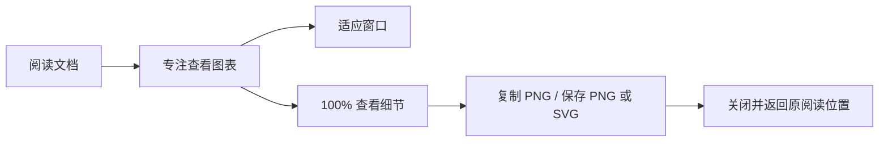

# 阅读体验验收

使用目录跳到图表，再使用左上角后退/前进返回。关闭 App 后重新打开，检查阅读位置和文档缩放。

[打开关联文档](linked.md)

## 第 1 节

这是第 1 节的独立段落。用于检查缩放、目录跳转和阅读位置保持。 阅读体验应当连续自然。 阅读体验应当连续自然。 阅读体验应当连续自然。 阅读体验应当连续自然。 阅读体验应当连续自然。 阅读体验应当连续自然。 阅读体验应当连续自然。 阅读体验应当连续自然。 阅读体验应当连续自然。 阅读体验应当连续自然。 阅读体验应当连续自然。 阅读体验应当连续自然。 阅读体验应当连续自然。 阅读体验应当连续自然。

## 第 2 节

这是第 2 节的独立段落。用于检查缩放、目录跳转和阅读位置保持。 阅读体验应当连续自然。 阅读体验应当连续自然。 阅读体验应当连续自然。 阅读体验应当连续自然。 阅读体验应当连续自然。 阅读体验应当连续自然。 阅读体验应当连续自然。 阅读体验应当连续自然。 阅读体验应当连续自然。 阅读体验应当连续自然。 阅读体验应当连续自然。 阅读体验应当连续自然。 阅读体验应当连续自然。 阅读体验应当连续自然。

## 第 3 节

这是第 3 节的独立段落。用于检查缩放、目录跳转和阅读位置保持。 阅读体验应当连续自然。 阅读体验应当连续自然。 阅读体验应当连续自然。 阅读体验应当连续自然。 阅读体验应当连续自然。 阅读体验应当连续自然。 阅读体验应当连续自然。 阅读体验应当连续自然。 阅读体验应当连续自然。 阅读体验应当连续自然。 阅读体验应当连续自然。 阅读体验应当连续自然。 阅读体验应当连续自然。 阅读体验应当连续自然。

## 第 4 节

这是第 4 节的独立段落。用于检查缩放、目录跳转和阅读位置保持。 阅读体验应当连续自然。 阅读体验应当连续自然。 阅读体验应当连续自然。 阅读体验应当连续自然。 阅读体验应当连续自然。 阅读体验应当连续自然。 阅读体验应当连续自然。 阅读体验应当连续自然。 阅读体验应当连续自然。 阅读体验应当连续自然。 阅读体验应当连续自然。 阅读体验应当连续自然。 阅读体验应当连续自然。 阅读体验应当连续自然。

## 第 5 节

这是第 5 节的独立段落。用于检查缩放、目录跳转和阅读位置保持。 阅读体验应当连续自然。 阅读体验应当连续自然。 阅读体验应当连续自然。 阅读体验应当连续自然。 阅读体验应当连续自然。 阅读体验应当连续自然。 阅读体验应当连续自然。 阅读体验应当连续自然。 阅读体验应当连续自然。 阅读体验应当连续自然。 阅读体验应当连续自然。 阅读体验应当连续自然。 阅读体验应当连续自然。 阅读体验应当连续自然。

## 第 6 节

这是第 6 节的独立段落。用于检查缩放、目录跳转和阅读位置保持。 阅读体验应当连续自然。 阅读体验应当连续自然。 阅读体验应当连续自然。 阅读体验应当连续自然。 阅读体验应当连续自然。 阅读体验应当连续自然。 阅读体验应当连续自然。 阅读体验应当连续自然。 阅读体验应当连续自然。 阅读体验应当连续自然。 阅读体验应当连续自然。 阅读体验应当连续自然。 阅读体验应当连续自然。 阅读体验应当连续自然。

## 第 7 节

这是第 7 节的独立段落。用于检查缩放、目录跳转和阅读位置保持。 阅读体验应当连续自然。 阅读体验应当连续自然。 阅读体验应当连续自然。 阅读体验应当连续自然。 阅读体验应当连续自然。 阅读体验应当连续自然。 阅读体验应当连续自然。 阅读体验应当连续自然。 阅读体验应当连续自然。 阅读体验应当连续自然。 阅读体验应当连续自然。 阅读体验应当连续自然。 阅读体验应当连续自然。 阅读体验应当连续自然。

## 第 8 节

这是第 8 节的独立段落。用于检查缩放、目录跳转和阅读位置保持。 阅读体验应当连续自然。 阅读体验应当连续自然。 阅读体验应当连续自然。 阅读体验应当连续自然。 阅读体验应当连续自然。 阅读体验应当连续自然。 阅读体验应当连续自然。 阅读体验应当连续自然。 阅读体验应当连续自然。 阅读体验应当连续自然。 阅读体验应当连续自然。 阅读体验应当连续自然。 阅读体验应当连续自然。 阅读体验应当连续自然。

## 图表验收

鼠标放在图上双指缩放；双指双击恢复图表 100%。点击专注查看，检查适应窗口、100%、复制 PNG、保存 PNG/SVG，再关闭返回。

## 附录 1

导出只包含图表，工具栏不应出现在图片中。 导出只包含图表，工具栏不应出现在图片中。 导出只包含图表，工具栏不应出现在图片中。 导出只包含图表，工具栏不应出现在图片中。 导出只包含图表，工具栏不应出现在图片中。 导出只包含图表，工具栏不应出现在图片中。 导出只包含图表，工具栏不应出现在图片中。 导出只包含图表，工具栏不应出现在图片中。 导出只包含图表，工具栏不应出现在图片中。 导出只包含图表，工具栏不应出现在图片中。 导出只包含图表，工具栏不应出现在图片中。 导出只包含图表，工具栏不应出现在图片中。

## 附录 2

导出只包含图表，工具栏不应出现在图片中。 导出只包含图表，工具栏不应出现在图片中。 导出只包含图表，工具栏不应出现在图片中。 导出只包含图表，工具栏不应出现在图片中。 导出只包含图表，工具栏不应出现在图片中。 导出只包含图表，工具栏不应出现在图片中。 导出只包含图表，工具栏不应出现在图片中。 导出只包含图表，工具栏不应出现在图片中。 导出只包含图表，工具栏不应出现在图片中。 导出只包含图表，工具栏不应出现在图片中。 导出只包含图表，工具栏不应出现在图片中。 导出只包含图表，工具栏不应出现在图片中。

## 附录 3

导出只包含图表，工具栏不应出现在图片中。 导出只包含图表，工具栏不应出现在图片中。 导出只包含图表，工具栏不应出现在图片中。 导出只包含图表，工具栏不应出现在图片中。 导出只包含图表，工具栏不应出现在图片中。 导出只包含图表，工具栏不应出现在图片中。 导出只包含图表，工具栏不应出现在图片中。 导出只包含图表，工具栏不应出现在图片中。 导出只包含图表，工具栏不应出现在图片中。 导出只包含图表，工具栏不应出现在图片中。 导出只包含图表，工具栏不应出现在图片中。 导出只包含图表，工具栏不应出现在图片中。

## 附录 4

导出只包含图表，工具栏不应出现在图片中。 导出只包含图表，工具栏不应出现在图片中。 导出只包含图表，工具栏不应出现在图片中。 导出只包含图表，工具栏不应出现在图片中。 导出只包含图表，工具栏不应出现在图片中。 导出只包含图表，工具栏不应出现在图片中。 导出只包含图表，工具栏不应出现在图片中。 导出只包含图表，工具栏不应出现在图片中。 导出只包含图表，工具栏不应出现在图片中。 导出只包含图表，工具栏不应出现在图片中。 导出只包含图表，工具栏不应出现在图片中。 导出只包含图表，工具栏不应出现在图片中。
