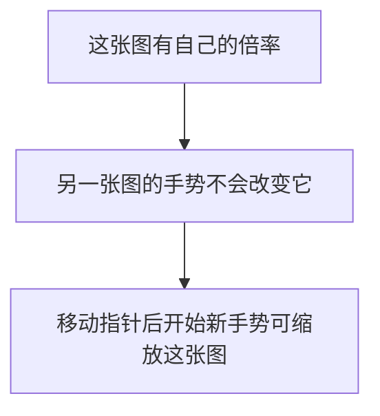

# Zoom Test Fixture

This file is a simple fixture for manual zoom verification.

## Instructions

1. Open this file in Finder.
2. Press Space to QuickLook preview.
3. Try:
   - `Cmd` + `+` / `-` / `0`
   - `Cmd` + scroll wheel / trackpad scroll
   - Trackpad pinch gesture

## Content

Repeatable text block (for visual scaling):

Lorem ipsum dolor sit amet, consectetur adipiscing elit. Sed do eiusmod tempor incididunt ut labore et dolore magna aliqua.

```javascript
function zoomTest() {
  return "Zoom should scale code blocks too";
}
```

| Column A | Column B | Column C |
|---|---|---|
| 1 | 2 | 3 |
| 4 | 5 | 6 |

## Mermaid 图上双指缩放

在图上双指双击可恢复该图的 100% 局部倍率，同时保留文档整体倍率；正文上双指双击恢复文档 100%。

把指针放在下面的图上双指缩放：只改变该图，文字、其他图和按钮大小应保持不变。先按 `+` 再双指，或先双指再按 `+`，倍率应连续。图太宽时可在图中横向滚动。


## 第二张图保持独立



## 正文缩放

把指针移到这段文字上再开始双指缩放：正文与图表应一起放大，目录和图表的 `− / 百分比 / +` 按钮保持原尺寸。`Cmd+0` 重置正文倍率，各图自己的倍率通过百分比按钮重置。
