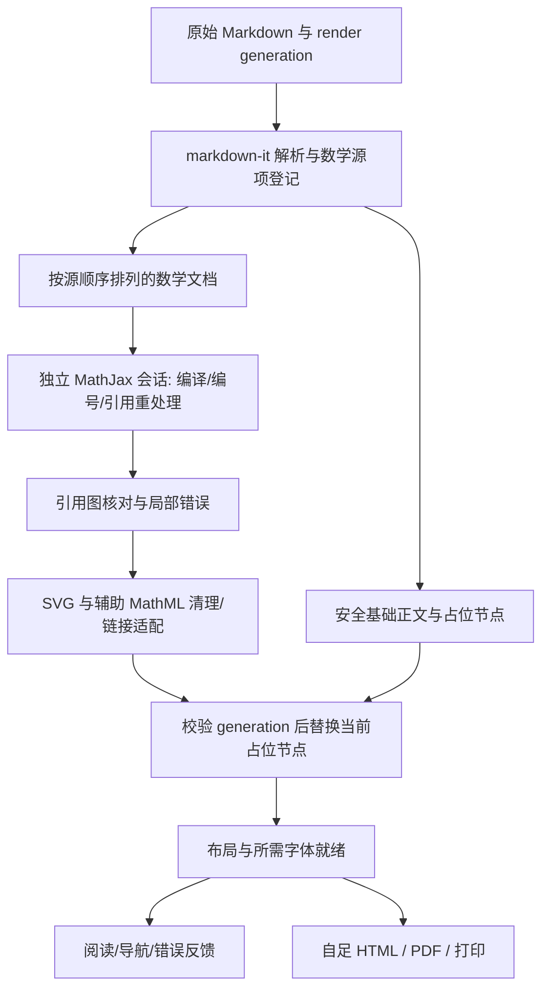

# Issue #64 数学渲染详细设计

日期：2026-11-04。状态：主要功能已实现，独立验收仍在进行，尚未达到完整发布门槛。
用户已确认方案并授权实现及端到端验证。本文件保留设计契约与实施决策；实际证据和未完成项以 `docs/debug/ISSUE_64_ACCEPTANCE_STATUS.md` 及 OpenSpec 任务清单为准。

总体范围与原文逐章盘点见 [总体方案](ISSUE_64_MATH_RENDERING.md)，固定语料与实验见 `docs/research/issue64/`。

## 1. 决策记录

| 决策 | 具体选择 | 依据与代价 |
| --- | --- | --- |
| 正文数学引擎 | MathJax 4.1.3，整文档语义，版本锁定 | 原文有效项、前向引用和 AMS 语义已通过隔离引擎实验 |
| 输出 | SVG，`fontCache: none`，不做行内自动拆分 | 实施阶段直接 path 对照降低 SVG use/shadow-tree 成本；1000 项 DOM 约 8.4 MiB，仍低于 10 MiB 门槛；内存总体仍待验收 |
| 辅助语义 | 显式加载 assistive MathML；不加载运行时语音/盲文/Explorer Worker | 两个原生输出实验均生成 13 份辅助 MathML，worker-src none 可完成；真实 VoiceOver 是发布门槛 |
| 加载方式 | Vite 静态打包显式源码模块，运行时按需 import；字体动态数据本地化 | 不直接把完整 CDN bundle 或 node_modules 拷入产品；不新增 Worker 权限 |
| TeX 包 | base、ams、newcommand、textmacros；一个只处理身份/诊断的本地适配包 | 支持所需公式与受限宏；不启用 autoload、require、noundefined、texhtml、任意 HTML 宏 |
| 标记与编号 | 自定义一次注册的 AMS tags 子类；每次渲染创建实例 | 避免空格标签 ID 碰撞、对象继承键误判及每会话 tagformat 全局类注册增长 |
| Markdown 识别 | 在 markdown-it token 层建立数学源项，代码和普通 HTML 属性保持保护 | 已处理的 DOM 无法还原被转义/分列的原始 TeX |
| 清理策略 | `safe-html.ts` 新增受控 math profile，仍复用 DOMPurify | 实测现有 document profile 会删除全部 SVG use，diagram profile会删除 mjx 外层容器 |
| 数学图片资源 | 数学输出不支持 `mglyph`、SVG `image` 或 MathML 内嵌 HTML `img`；保留公式源码并通过共享错误界面说明边界 | 在采用到主文档前，从 DOMPurify 的独立文档片段提取 MathML；不能等排版后才移除图片，否则已可能发起资源请求。普通文档图片沿用既有策略 |
| 导出 | 渲染结束后导出静态 SVG + 样式 + 辅助 MathML + 标准锚点 | 无 MathJax 脚本、字体网络请求或本地 scheme；PDF链接能力单独检查 |
| 原功能依赖 | Typst 和 Mermaid 维持各自路径，KaTeX 依赖不随正文迁移删除 | 其内部数学依赖不等于正文引擎选择 |

比较采用相同辅助语义配置，不能用关闭无障碍的结果给某个引擎制造性能优势。标准 `href` 在选定的辅助 MathML 配置中直接生成；仍保留对 `data-mjx-href` 的受控适配和回归检查，防止未来配置变化破坏导出。

## 2. 数据流与模块职责



| 模块 | 责任 | 不承担 |
| --- | --- | --- |
| `math-syntax.ts`（新增） | delimiters、fence、指定 AMS 环境、原文范围、token 元数据 | TeX 命令解释、全局字符串替换 |
| `math-syntax.ts` / `math-engine.ts` 的导出类型 | 源项、会话结果与诊断契约；实现未单设 math-model 文件 | 原生 bridge |
| `math-engine.ts`（新增） | 延迟加载、独立 TeX/MathDocument、AMS 适配、MathML/SVG 输出 | 私自写当前预览 DOM |
| `index.ts` / `math-engine.ts` | generation、顺序、引用核对、展示/失败/清理生命周期；实现未单设 math-document 文件 | 共享可变数学会话状态 |
| `safe-html.ts` | document/diagram/math 三种明确输入策略 | 放行所有自定义元素或任意 URI |
| `math-layout.ts` | 仅对已登记且超出所在文本块宽度的行内公式启用可聚焦的局部滚动；响应尺寸变化并清理监听 | 改写正常公式的基线、全局缩放、TeX 语义 |
| `index.ts` | 现有入口调用、开关兼容、导航、目录、源码及渲染完成承诺 | 内嵌整套数学实现 |
| `export-readiness.ts` | 当前会话终态、数学错误、布局/字体/图像就绪 | 根据“Promise resolved”推断没有数学错误 |
| `error-feedback.ts` / 原生 ErrorIncident | 安全事件、恢复与反馈、六种语言 | 上传数学源码或标签文字 |

下列伪接口保留原始设计意图，不是可直接导入的生产 API。实际类型分别为 `MathSource`、`MathEngineResult`；generation 与发布控制由 `index.ts` 持有，输入预算由 `math-limits.ts` 执行。实现采用协作式失效检查，不声称能用 Promise 超时中断同步排版。

```ts
type MathInputKind = 'tex-inline' | 'tex-display' | 'mathml';
interface MathSource {
  id: string;                    // 每次 render 内不可伪造的源项 ID
  kind: MathInputKind;
  raw: string;                   // 含原始定界符/围栏，供关闭或失败显示
  payload: string;               // 引擎输入，TeX 不含定界符
  firstLine: number;
  lastLine: number;
  sourceOrdinal: number;         // 原文顺序，不采用渲染后 DOM 顺序
}
type MathFailureCode =
  | 'syntax' | 'duplicate-label' | 'unresolved-reference'
  | 'resource-unavailable' | 'input-limit' | 'render-timeout';
interface MathDiagnostic {
  sourceId: string;
  code: MathFailureCode;
  firstLine: number;
  detailForLocalDisplay: string; // 仅本地，绝不直接进入 bridge payload
}
interface MathRenderResult {
  state: 'ready' | 'degraded' | 'cancelled';
  generation: number;
  rendered: number;
  diagnostics: readonly MathDiagnostic[];
}
interface MathDocumentSession {
  render(sources: readonly MathSource[]): Promise<MathRenderResult>;
  readyForExport(): Promise<void>;
  dispose(): void;
}
```

`index.ts` 只持有当前 session。源码映射保存在会话内存；与 DOM 的绑定使用本轮随机 ticket 和内部 WeakMap，用户 HTML 上的同名 class/data 属性不能登记为可信数学项。源位置先承诺原始行范围，不从已归一化字符串伪造字节偏移。CRLF、引用前缀、列表缩进、表格转义和脚注的范围映射均需测试。

## 3. Markdown 语法契约

| 输入 | 识别与结束条件 |
| --- | --- |
| `$...$` | 开头后不是空白，结尾前不是空白；继承当前关闭美元后不紧接数字的货币保护；允许同一段内软换行，不跨空段 |
| `\(...\)` | 在 escape 规则前识别；只消费成对边界，不跨空段；双反斜杠等字面转义仍由 Markdown 处理 |
| `$$...$$` / `\[...\]` | 独立显示块，支持单行及多行、容器内合法缩进；边界附近只允许规定空白，不把任意段落内双美元改成块 |
| `math` fence | 按 markdown-it 原有 fence/缩进规则识别，语言标记为 math；普通 fence 中的相同内容保持代码 |
| `equation/align/gather` 及星号形式 | 独立块，明确环境白名单；进入数学 token 后由 MathJax 处理嵌套内容 |
| `\ref{...}` / `\eqref{...}` | 数学内由引擎处理；段落内通过受限 inline 规则生成引用源项，不扫描代码/属性/URL |
| 原生 MathML | 从清理后的合法展示型节点收集；取命名空间与源范围；注释/代码中的 `<math>` 不进入引擎 |

货币与数学有天然歧义，确定的语法规则不能保证猜出所有未转义金额；原附件的 `\$` 明确保持正文。`\lvert`、`\rvert` 及符合 GFM 的 `\|` 用法必须通过；不得为识别表格中的数学竖线改坏普通 GFM 分列。

候选 tokenizer 以原文和保护用例验收。允许使用现成插件提供规则，但必须能够把渲染交给 document session、保留 source map、关闭输出引擎耦合。现有 `markdown-it-katex` 不具备这些要求，不能只替换 renderToString 函数。

脚注渲染可能把定义移动到文末，折叠块可能不可见；数学顺序按原始行/源项顺序确定，不能按可见 DOM 或滚动顺序编号。含公式标题的大纲使用安全纯文本描述，不把 SVG/辅助树内容写进标题。

## 4. 数学语义和身份

### 4.1 编号规则

- `tags: ams`；普通 `$$`/`\[` 不自动编号；`equation/align/gather` 非星号环境依 AMS 编号，星号不自动编号。
- 显式 `\tag{1}` 不消耗自动计数器，因此后续第一个自动编号仍可为 `(1)`。不要误把视觉号码唯一性当作标签唯一性。
- `\tag*{B}` 显示 B，`\ref` 显示 B，`\eqref` 显示 `(B)`；`\notag` / `\nonumber` 取消相应行编号。
- 有 label 但没有有效编号的公式仍可排版；引用它时出现“未解析引用”，不擅自补号。

### 4.2 身份适配器

新增小型 `FluxAmsTags extends AmsTags`，以固定名字注册一次，每个会话单独实例化。只适配身份容器、ID 和元数据，继续使用上游的 AMS 计数/重处理逻辑。版本升级必须跑该适配器的契约测试。

- label 精确比较，不隐式 trim、Unicode 归一化或空格替换。
- label/ID 字典使用无原型对象或 Map 边界；在构造、reset、startEquation 后均保证无继承键。实测 `constructor` 在原生默认实现中被误判为重复标签。
- 有标签 ID 为 `fxeq-{generationNonce}-l-{UTF8Hex(label)}`；无标签编号目标用 `fxeq-{generationNonce}-u-{sourceOrdinal}-{rowOrdinal}`。两种空间分离；单个 label 上限 256 UTF-8 字节。
- `a b` 和 `a_b` 必须有不同 ID。实测 MathJax 默认规则把两者映射到同一个 `mjx-eqn:a_b`。
- 前向重编译须复用同一 source/row 身份；生成的 ID 不是产品对外的持久 URL API。跨 render 比较归一化 nonce 后的语义，不要求随机内部 ID 相等。
- 使用本轮命名空间，避免隐藏测量树与当前正文同时存在时 ID 重复；检查引用仅在当前会话根内进行。

### 4.3 引用与失败目标

从真实 TeX 解析/编译后的语义节点和 tags 状态构建引用图；不对 TeX 源码用正则解析 label/ref，因为宏、注释和转义会使结果失真。对版本内部字段的依赖集中在适配器内。

引用合法必须同时满足：标签被当前文档有效定义、具有非占位编号、目标节点位于当前输出、目标公式未失败。异常未抛出不构成成功证据。重复 label 不覆盖首个有效声明；失败声明不成为可点击目标。

标准 fragment href 只取当前会话核验通过的目标；拒绝 `#` 空目标和外部跳转。普通文字中的引用和 SVG 内引用均支持键盘 focus/Enter。链接嵌套场景不生成嵌套 `<a>`；错误保持内联，反馈控件使用既有外置模式。

## 5. 会话、布局与资源

状态机：`created → loading → compiling → typesetting → validating → ready/degraded`；任一阶段可到 `cancelled`，销毁后不得写当前页面。

1. 基础 Markdown 可先显示；数学占位保留原文或简洁加载状态。当前 generation 保存在闭包中，每个 await 后和 DOM 发布前检查。
2. 每次渲染创建独立 TeX/MathML/MathDocument；复用模块，不共享 labels、宏或 mutable font-cache IDs。禁止并发任务操作同一 TeX 对象。
3. 所有源项按 sourceOrdinal 进入同一语义文档，完成前向引用重处理；绝不逐式降级到另一引擎。
4. 测量树附着到页面并继承真实字体/宽度，使用不可见布局而不是 `display:none`；不可聚焦、不可读屏，不影响正文滚动。处理完成后只把经过清理的结果发布到对应可信占位节点。
5. DOM 发布后强制一次布局，再等待所需字体；经过事件循环检查是否又启动字体请求，有限次稳定后才标记 ready。实测提前取得一次 `document.fonts.ready` 后再触发布局，仍可能有多个字体处于 loading。
6. 释放临时树、engine items、observer 和字体 cache 引用；切换文档、源模式或开关时取消旧会话。引用/目录定位和滚动恢复等待新布局。

资源清单：`@mathjax/src` 显式用到的模块、NewCM SVG 动态字形数据、assistive-mml、许可文件。采用 Vite 构建后的闭包资产清单，不复制其他输出引擎、菜单、SRE 或未启用扩展；无公式文件不触发数学 import。

数学 profile 禁止 Worker，全部脚本/字体数据使用本地 scheme；仍使用系统字体显示 `\text{条件概率}` 等非数学文本。辅助 MathML 留给原生可访问性桥接；不宣称提供未实现的独立语音/盲文 Explorer。

## 6. 清理、阅读与导出

### 输出清理

`sanitizeMathHTML` 位于现有 `safe-html.ts`，只对可信 source ticket 对应的引擎结果调用：

- 精确允许 `mjx-container`、`mjx-assistive-mml` 及所需 SVG/MathML；不使用放行全部 `mjx-*` 的泛规则。
- 保留已核验局部 defs/use、必要几何/颜色/ARIA 属性；拒绝事件属性、foreignObject、任意脚本/样式注入、外部 use 和未核验链接。
- 运行时样式来自已打包引擎 stylesheet/受控应用 CSS；不接受文档提供的 style 标签来补渲染。
- 清理后再次核对 use→defs、reference→target、辅助树和尺寸。当前 document 清理会把 152 个 use 全删掉，diagram 清理虽保留 use 却丢外壳，不能直接复用现状宣告兼容。

### 阅读与辅助能力

数学根 `direction:ltr; unicode-bidi:isolate`；显示公式局部横向滚动，编号不能盖住正文。字号、主题和宽度变化触发必要重新测量，保留文档标签语义。

搜索不得向 SVG text 或隐藏辅助树插入普通 HTML `<mark>`。首版将数学源项作为一个可定位搜索单位，以原始 TeX/MathML 的安全文本建立索引，命中时高亮整个公式；源码模式保留精确文字查找。公式复制取会话 raw，不从 SVG path 或辅助树反推源码。

### 导出契约

- `readyForExport` 要求当前 generation 的结果为 ready；degraded 保留预览，但导出以已有错误界面说明未能完整导出，不能误报成功。
- 等待引擎、引用重处理、清理核对、布局、所需字体和已有图片资源；沿用整体导出 deadline，避免每项重试各延长一轮。
- HTML 保存静态 SVG、局部 defs、必要 CSS、辅助 MathML及标准 href；删除测量树、loading、反馈/复制控件和运行时事件依赖。不得残留本地 scheme。
- 打印/PDF以可打印宽度重新测量；保护显示公式整体分页，过高公式采用明确可读策略，不静默裁切。两页间引用链接是否被 AppKit print 保留需验收；可见编号和完整公式是硬要求，PDF链接能力必须如实说明。

## 7. 限额与性能门槛

初版资源合同建议：单数学源项 64 KiB、单 label 256 UTF-8 字节、单文档 5000 个数学项/2 MiB 数学源码；maxBuffer 64 KiB、maxMacros 1000，按本地已包含版本验证支持的数组模板限制。越界只使相关数学项或尾部数学处理降级，保留原始文档及一个可访问的错误入口。

异步模块/资源就绪使用现有 15 秒导出资源 deadline；CLI 沿用 60 秒总 deadline。JS Promise.race 不能中断同步 TeX 计算，不能宣称它提供 CPU 硬超时。依靠输入/展开限制约束工作量；压力样例若仍造成不可接受阻塞，必须调整批处理或引入独立计算隔离并重新评审，不能假装计时器已解决。

当前机器原型测量用于选择和设预算，不代替旧系统/真实宿主基准。冻结的开发参考机门槛：原文首次数学排版 p95 ≤150 ms（不含进程启动）、100 项暖态 p95 ≤150 ms、1000 项暖态 p95 ≤2000 ms；首次数学运行时加载资产 ≤3 MiB；1000 项数学 DOM ≤10 MiB。无数学文档新增数学资源请求为 0，端到端 p95 回归 ≤max(10%,10ms)。

最旧系统/Intel、WebContent RSS 与包体整体增长需要实施阶段在明确机器上建立基线；这些缺测项保留为发布阻断项，不把当前 M5 Max 的数值套用过去。当前测量定义、样本和限制见 `docs/research/issue64/design-validation.md`。

## 8. 具体实施批次

| 批次 | 先失败的验收 | 主要修改 | 完成证据 |
| --- | --- | --- | --- |
| A | 13 项识别、代码/转义保护、列表/脚注源序 | math-model、math-syntax、测试夹具 | tokenizer 与原文源项对应，开关无副作用 |
| B | 前向引用、a b/a_b、constructor、失败/无编号目标、宏隔离 | engine、静态注册 tags adapter、document session | 真实 MathJax 语义与独立 TeX 标签一致 |
| C | sanitizer 删除 glyph/容器、错误链接、过期发布 | safe-html、会话发布、反馈映射 | 清理前后数学完整、旧任务不落盘/不更新当前 DOM |
| D | 目录/搜索/复制、RTL、主题/字号、设置兼容 | index、search、outline、样式、原生本地化 | DOM + 原生交互/截图/VoiceOver |
| E | 立即导出字体未就绪、HTML 离线链接丢失、PDF裁切 | export-readiness、HTML/CLI/PDF路径 | 实际导出重新打开、截图与链接检查 |
| F | 旧系统API、进程复用、压力/缺资产 | 构建兼容适配与真实宿主测试 | 冻结门槛全通过；发布报告与回退记录 |

每批独立验证后提交 Conventional Commit。逐批保留旧正文引擎内部回退开关供开发验收，不做逐公式动态混用；正式切换必须完整通过 A–F，回退是整个正文引擎与配置一起恢复。

## 9. 设计完成与产品完成

设计交付包括确定的架构、类型契约、语法/编号政策、边界处理、实测选型、独立期望、实现批次和发布门槛。当前设计可以进入实施评审。

产品完成还要求：最旧 macOS/Safari 14 真实验证、VoiceOver/键盘、App/QuickLook/Finder、生产构建 sanitizer/资源闭包、HTML/PDF和内存回归。ES 语法转译不能替代 API 兼容，特别要检查 MathJax 内部 Object.hasOwn 等现代 API；采用局部兼容适配/已验证 polyfill，不更改产品 macOS 11 最低支持版本。
