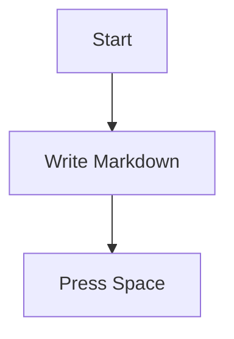

# FluxMarkdown 使用指南（新手友好）

这份文档面向 **普通用户**：帮你在 1 分钟内完成第一次成功预览，并在遇到问题时按“由浅入深”的顺序排查。

> 如果你是开发者/想看更底层的原理与命令行诊断，请直接跳到：
> - 高级排障：[`TROUBLESHOOTING.md`](TROUBLESHOOTING.md)

---

## 1) 先体验一次“它真的在工作”

1. 在 Finder 里找到一个 `.md` 文件
2. 选中它，按 **Space（空格）**
3. 你应该看到带样式的 Markdown 预览（而不是纯文本）

如果这一步成功了，后面只是可选增强。

---

## 2) 第一次使用（推荐流程）

### Step A：启动一次 App（很重要）

macOS 的 QuickLook 扩展通常需要宿主 App 被打开过一次，系统才会完成注册。

1. 打开 **Applications（应用程序）**
2. 启动 **FluxMarkdown** 一次
3. 出现欢迎窗口即可（不需要选择文件）

### Step B：确认 Quick Look 扩展已启用

如果你按空格仍然是旧预览：

1. 打开 **System Settings（系统设置）**
2. 进入 **Extensions（扩展）** → **Quick Look（快速查看）**
3. 确认 **FluxMarkdown / MarkdownPreview** 相关项已启用

---

## 3) 常见问题（由简到难）

### 3.1 按空格还是“没有变化”

按下面顺序逐项尝试：

1. **重启 Finder**：在 Dock 上右键 Finder 图标（按住 Option 更稳妥）→ Relauch（重新启动）
2. **清理 QuickLook 缓存**：打开“终端”，运行：

```bash
qlmanage -r
qlmanage -r cache
killall Finder
```

然后回到 Finder 再按一次空格。

### 3.2 “App is damaged / 无法验证开发者”

这是 macOS 的安全机制（下载的 App 带有隔离标记）导致的。

打开终端运行：

```bash
xattr -cr "/Applications/FluxMarkdown.app"
```

再重新打开 App。

### 3.3 预览能打开，但偶尔显示成纯文本

通常是系统选择了其他 QuickLook 插件或缓存。

1. 先按 **3.1** 的步骤清理缓存
2. 确认 FluxMarkdown 是 `.md` 的默认打开方式（可选）：右键文件 → Get Info → Open with

如果仍不稳定，请看高级排障：[`TROUBLESHOOTING.md`](TROUBLESHOOTING.md)

---

## 4) 如何使用 App（打开文件 / 拖拽 / 设置）

### 打开文件

- 方式 1：双击 `.md` 文件（若 FluxMarkdown 是默认打开方式）
- 方式 2：在欢迎窗口点击中间的 **+**，选择文件
- 方式 3：把文件直接拖到欢迎窗口的 **+** 区域

### 打开设置（Settings）

- 快捷键：**Cmd + ,**
- 或者在欢迎窗口点击 **Open Settings**

---

## 5) 小贴士：如何写出“预览效果更好”的 Markdown

FluxMarkdown 支持 Mermaid、KaTeX、GFM 等。这里给你几个可复制粘贴的小示例：

### Mermaid



### KaTeX

行内：`$E = mc^2$`

块级：

```tex
\int_a^b f(x)\,dx
```

---

## 6) 仍然需要帮助？

1. 先看高级排障（包含更详细的检查命令与原因解释）：[`TROUBLESHOOTING.md`](TROUBLESHOOTING.md)
2. 报告 Bug：选择应用菜单“帮助 → 报告问题”。
   - 在本地预览中填写复现步骤和预期结果，检查自动生成的诊断信息；可以编辑或取消附带诊断。
   - 点击“继续前往 GitHub”打开 Bug Report 表单，检查后在 GitHub 页面提交，需要 GitHub 账号。提交的问题会公开显示。
   - 报告较长时，GitHub 预填摘要会缩减；可用“复制报告”或“保存报告”保留完整内容，再粘贴或附加到表单。无法打开浏览器时也可以先复制/保存。
3. 建议新功能：选择“帮助 → 建议新功能”，打开 Feature Request 表单。此入口不自动附带设置历史。
4. 设置历史保存在本地，保留最近 200 条变化，不按时间过期；另保留最近 20 条启动快照。超过 256 KiB 时淘汰最旧记录。
   - 记录包含时间、修改前后的值，以及设置面板、工具栏、旧配置迁移或外部变化观察等来源。连续拖动字体滑块会合并，重复选择同一值不会产生事件。
   - 诊断包含应用/系统版本、当前设置及语言解析信息，不自动收集文档内容、文件名、路径或原始日志。
   - 新版本启用后才开始记录，无法恢复过去的操作；外部变化的记录时间是观察时间，无法确定操作者。异常退出前尚未写入的操作可能缺失。
   - 在报告窗口中点击“清空设置历史”可删除变化记录和启动快照，实际设置保持不变。
5. 也可直接访问 GitHub Issues：<https://github.com/xykong/flux-markdown/issues>。


## 分享复现文档与查看回复

在错误旁选择“附带复现材料…”可检查或编辑失败片段，也可选择完整文档及引用资源，保存为 ZIP。在 GitHub 页面从 Finder 拖入 ZIP，再提交 Issue。附件会在选择后立即上传到 GitHub，公开 Issue 的材料可能被其他人访问；不附文档仍可反馈。App 不会自动上传全文。

“帮助 → 我的反馈”可查看关联状态和回复；找不到已提交的问题时，可粘贴该 FluxMarkdown Issue 链接进行关联。App 运行期间检查公开回复，退出期间的回复会在下次运行后补查。未读标记保留到你点击对应回复并成功打开浏览器；仅打开列表、关闭通知或重启不会清除。系统通知为可选，不影响 App 内的未读提示。


### 默认填写内容和附带文档

点击错误区域的“反馈”会打开已填写问题摘要的对话框，并默认勾选当前文档，自动在本地准备 ZIP。你可以编辑反馈内容、查看或更换附件，或取消“附带当前文档”。准备失败会明确提示，不会声称文件已附上。继续后需在 GitHub 页面拖入准备好的 ZIP，再确认发布；文件不会因打开对话框而上传。
